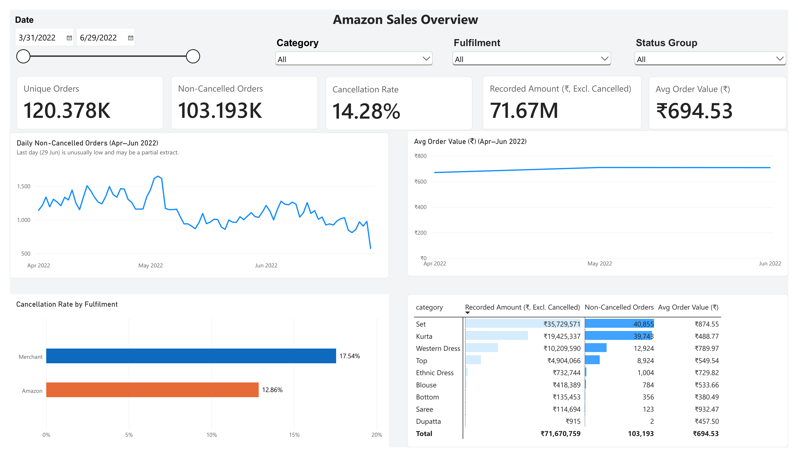
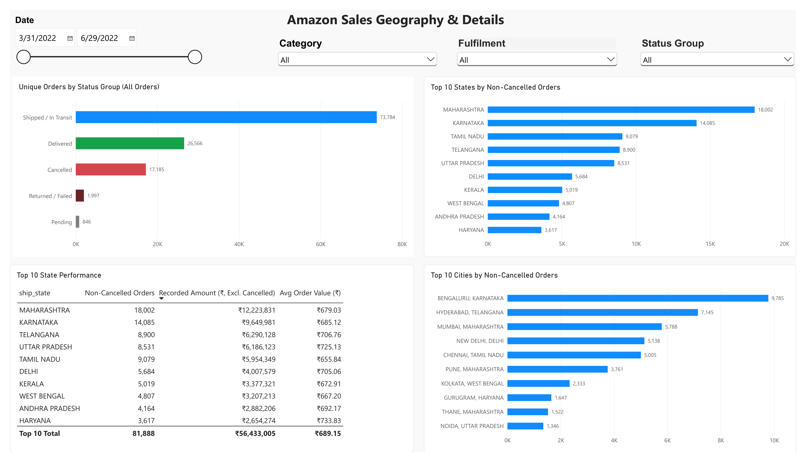

# Amazon Sales Analysis
> **Status: Completed**

## Key Highlights




- Analyzed **128,969 records** representing **120,378 unique orders**.
- `Set` and `kurta` together account for approximately **76.95%** of non-cancelled Recorded Amount.
- Merchant-fulfilled orders have a higher cancellation rate (**17.54%**) than Amazon-fulfilled orders (**12.86%**).
- Daily order volume declined from April to June, while average Recorded Amount per order remained relatively stable at around **₹670–₹710**.
- Quantity and Recorded Amount show a **moderate positive Pearson correlation of 0.57**, while the Spearman correlation is **0.334**.

## Project Overview

This project is an end-to-end data analytics project focused on analyzing Amazon sales data to understand overall sales performance, identify patterns in customer orders and product categories, and evaluate key business metrics.

The goal is to uncover trends in product performance, order behavior, fulfilment methods, cancellations, promotions, and geographic performance that can support data-driven business decisions and highlight potential business opportunities.

## Business Questions

- Which product categories generate the highest Recorded Amount?
- How does order activity change over time?
- How do cancellation rates differ by fulfilment method?
- How does geographic performance vary across states and cities?
- How does promotion usage relate to order value and fulfilment method?
- What patterns can be identified in order quantity and order value?

## Dataset

- **Source:** [E-Commerce Sales Dataset - Kaggle](https://www.kaggle.com/datasets/thedevastator/unlock-profits-with-e-commerce-sales-data/data)
- **Raw Size:** 128,975 rows and 24 columns
- **Period:** March 31, 2022 to June 29, 2022
- **Currency:** INR (Indian Rupees)

The raw and cleaned CSV files are not stored in this repository.

The raw dataset can be downloaded from Kaggle and placed in:

```text
data/raw/Amazon Sale Report.csv
```

The cleaning script generates the cleaned dataset locally at:

```text
data/cleaned/amazon_sales_cleaned.csv
```

## Tools

The following tools were used to clean, analyze, and visualize the data:
- Python
- Pandas
- PostgreSQL
- Power BI
- Git & GitHub

## Data Inspection

The raw dataset was inspected using Python and Pandas before cleaning.

The inspection included:

- Checking dataset dimensions and column names
- Reviewing data types
- Identifying missing values
- Checking for duplicate records after excluding technical columns
- Investigating missing `Amount` and `currency` values
- Reviewing non-null currency values
- Investigating the relationship between `Fulfilment` and `fulfilled-by`
- Reviewing missing shipping location data
- Investigating missing `Courier Status` values
- Reviewing promotion ID availability
- Investigating zero-amount transactions
- Reviewing distributions of key columns such as `Status`, `Category`, `Qty`, and `B2B`
- Inspecting unusually high quantity and amount values
- Generating summary statistics for numeric columns

### Key Findings

- The raw dataset contains **128,975 rows and 24 columns**.
- Six duplicate records were identified after excluding the technical `index` and `Unnamed: 22` columns.
- `Amount` and `currency` have **7,795 missing values each** in the raw dataset and share the same missing-value pattern.
- All non-null currency values were confirmed to be INR (Indian Rupees).
- Missing `fulfilled-by` values are structurally related to Amazon-fulfilled orders.
- Shipping location fields are missing together in 33 records.
- Most missing `Courier Status` values are associated with cancelled orders.
- Zero-amount transactions could not be fully explained by promotions or zero quantity and were therefore retained.
- Unusually high quantity and amount values were inspected and appeared plausible, so they were not removed.
- The `Date` column was stored as text and required conversion to datetime.


## Data Cleaning

The dataset was cleaned using Python and Pandas to improve data quality and prepare it for analysis.

The cleaning process included:

- Removing unnecessary technical columns such as `index` and `Unnamed: 22`
- Standardizing column names using lowercase and snake_case formatting
- Removing fully duplicated records
- Converting the `Date` column to datetime format
- Converting `ship_postal_code` to string format
- Replacing expected missing `fulfilled_by` values with `Not Applicable`
- Replacing missing promotion IDs with `No Promotion ID`
- Replacing missing shipping location values with `Unknown`
- Handling missing `Courier Status` values based on order status
- Keeping missing `amount` and `currency` values as null because their true values were unknown
- Standardizing `ship_city` and `ship_state` using trimmed uppercase values
- Standardizing category names
- Normalizing known state naming and abbreviation variants
- Creating a combined `city_state` field for consistent geographic analysis
- Performing final validation on dataset shape, missing values, data types, and duplicates

### Cleaning Results

- The cleaned dataset contains **128,969 rows and 23 columns**.
- Six duplicate records were removed.
- `amount` and `currency` are the only columns with remaining missing values, with **7,792 missing values each** after duplicate removal.
- Column names and selected text fields were standardized.
- Known state name abbreviations and spelling variants were standardized.
- Date and postal code data types were corrected.
- A `city_state` field was created for geographic analysis.
- No duplicate rows remain after cleaning.

## Exploratory Data Analysis

Exploratory data analysis was performed using Python and Pandas on the cleaned dataset.

The full dataset was used for order-status analysis, while non-cancelled records were used as the main population for business analysis.
Non-cancelled records include all statuses except `Cancelled`, including returned, pending, failed, and other non-final statuses.
The `Amount` field is therefore referred to as **Recorded Amount** rather than confirmed revenue or net sales.
All non-null currency values were confirmed to be **INR (Indian Rupees)**, so monetary values are reported in ₹.

### Key Findings

- The cleaned dataset contains **128,969 records** and **120,378 unique orders**.
- `Shipped` is the most common order status at **60.50%** of unique orders, while `Cancelled` accounts for **14.28%**.
- Non-cancelled records account for approximately **₹71.67M** in Recorded Amount.
- **Set** is the leading category by Recorded Amount at approximately **₹35.73M**, despite having a similar number of unique orders to `Kurta`.
- Average Recorded Amount per order for `Set` is substantially higher than for `Kurta`.
- On a daily basis, unique orders decreased by **16.57%** from April to May and by another **4.36%** from May to June.
- Recorded Amount per day decreased by **11.65%** from April to May and by **4.54%** from May to June.
- Average Recorded Amount per order increased from **₹670.41** in April to **₹709.96** in May and remained similar at **₹708.63** in June.
- **94.04%** of non-cancelled orders are single-unit orders.
- B2B represents only **0.71%** of non-cancelled orders but has a higher average Recorded Amount per order (**₹768.41**) than non-B2B orders (**₹694.01**).
- Amazon fulfilment accounts for **70.93%** of non-cancelled unique orders, while Merchant accounts for **29.07%**.
- Merchant orders have a higher cancellation rate (**17.54%**) than Amazon-fulfilled orders (**12.86%**).
- **Maharashtra** is the leading state with **18,002** non-cancelled unique orders.
- **Bengaluru, Karnataka** is the leading city-state combination with **9,785** non-cancelled unique orders.
- After state-name standardization, **Delhi** contains **5,748** non-cancelled unique orders, while **New Delhi, Delhi** contains **5,160**.
- Orders with a recorded Promotion ID represent **70.93%** of non-cancelled orders and have a higher average Recorded Amount per order.
- Promotion ID usage is strongly associated with fulfilment method, so the difference should not be interpreted as a direct promotion effect.
- Quantity and Recorded Amount have a **Pearson correlation of 0.57**, indicating a moderate positive linear relationship.
- The **Spearman correlation is 0.334**, indicating a weaker positive rank-based relationship.
- High-value outliers were reviewed using the IQR method.
- Many high-value orders also contained multiple units, and the amount-per-unit distribution did not provide evidence that these orders were obvious data errors, so the outliers were retained.

## SQL Analysis

SQL analysis was performed using PostgreSQL on the cleaned dataset to extend the Python EDA and apply database querying techniques such as CTEs, joins, conditional logic, ranking, filtering, and window functions.

Non-cancelled orders were used as the main population for the SQL analysis.

The `Amount` field continues to be referred to as **Recorded Amount** rather than confirmed revenue or net sales.

### Key Findings

- `Set` was the leading category by Recorded Amount across most states.
- The strongest state-category combination was **Maharashtra + Set**, with **6,736 unique orders** and approximately **₹5.76M** in Recorded Amount.
- Among non-cancelled orders, **99.81%** of Merchant-fulfilled orders had a recorded Promotion ID, compared with **59.09%** of Amazon-fulfilled orders.
- Using quartile thresholds calculated during the Python EDA (`Q1 = ₹459`, `Q3 = ₹824`), orders with known Recorded Amount were segmented into Low, Medium, and High Value groups.
- High Value orders represented approximately **25%** of orders with known Recorded Amount but contributed about **41.8%** of Recorded Amount.
- High Value orders had an average order value of **₹1,165.30**.
- `Set` contributed **49.85%** of non-cancelled Recorded Amount, while `Kurta` contributed **27.10%**.
- Together, `Set` and `Kurta` accounted for approximately **76.95%** of non-cancelled Recorded Amount.
- The top three categories — `Set`, `Kurta`, and `Western Dress` — accounted for approximately **91.20%**.
- Maharashtra was the leading state by Recorded Amount for **6 of the 9 product categories**.
- `Blouse` was led by Karnataka, `Saree` by Tamil Nadu, and `Dupatta` by Telangana.
- The running total of non-cancelled Recorded Amount reached **₹71.67M**, matching the Python analysis and providing an additional validation check.

## Power BI Dashboard

An interactive Power BI dashboard was created to present the main business findings and allow filtering across multiple dimensions.

The dashboard contains two pages.

### Amazon Sales Overview

The overview page includes:

- Unique Orders
- Non-Cancelled Orders
- Cancellation Rate
- Recorded Amount excluding cancelled orders
- Average Order Value
- Daily non-cancelled order trends
- Monthly Average Order Value
- Cancellation Rate by Fulfilment
- Category performance

The daily trend visual focuses on April through June because March contains only one day of data.

### Amazon Sales Geography & Details

The geography page includes:

- Order distribution by Status Group
- Top 10 States by Non-Cancelled Orders
- Top 10 State Performance
- Top 10 Cities using the combined `city_state` field


Both dashboard pages include synchronized slicers for:

- Date
- Category
- Fulfilment
- Status Group

## Recommendations

Based on the findings, the data suggests the following areas for further attention:

- **Focus on top categories:** `Set` and `Kurta` contribute approximately **76.95%** of non-cancelled Recorded Amount, so maintaining product availability and evaluating marketing opportunities for these categories may have the greatest potential business impact.
- **Review Merchant fulfilment:** Merchant-fulfilled orders have a higher cancellation rate (**17.54%**) than Amazon-fulfilled orders (**12.86%**). Potential causes such as inventory availability, processing time, and fulfilment operations warrant further investigation.
- **Investigate the order volume decline:** Daily order volume declined from April to June while average Recorded Amount per order remained relatively stable, suggesting that the decline was driven mainly by fewer orders rather than lower-value orders.
- **Explore B2B further:** B2B represents only **0.71%** of non-cancelled orders but has a higher average Recorded Amount per order (**₹768.41**) than non-B2B orders (**₹694.01**).
- **Consider regional differences:** Maharashtra leads overall, while Karnataka, Tamil Nadu, and Telangana lead specific categories such as `Blouse`, `Saree`, and `Dupatta`.

## Limitations

- `Recorded Amount` should not be interpreted as confirmed revenue or net sales. The non-cancelled population includes returned, pending, failed, and other non-final order statuses.
- `No Promotion ID Recorded` does not necessarily mean that no promotion was applied.
- Promotion ID usage is strongly associated with fulfilment method, so observed differences should not be interpreted as causal.
- Correlation indicates association, not causation.
- March contains only one day of data, while June ends on June 29.
- The final day also shows an unusually low order count and may represent a partial data extract, so monthly and end-of-period trends should be interpreted with caution.
- **7,795 raw records** have missing `Amount` and `currency` values.
- After duplicate removal, **7,792 cleaned records** remain missing these values.
- Known geographic naming and abbreviation variants were standardized, but source-specific or ambiguous location labels were retained when they could not be confidently corrected.
- The dataset covers approximately three months, so longer-term trends and seasonality cannot be reliably assessed.

## Project Structure

```text
amazon-sales-analysis/
├── data/
│   ├── raw/
│   │   └── .gitkeep
│   └── cleaned/
│       └── .gitkeep
├── images/
│   ├── dashboard_overview.png
│   └── dashboard_geography_details.png
├── powerbi/
│   ├── AmazonSalesDashboard.Report/
│   ├── AmazonSalesDashboard.SemanticModel/
│   └── AmazonSalesDashboard.pbip
├── python/
│   ├── data_inspection.py
│   ├── data_cleaning.py
│   └── data_analysis.py
├── sql/
│   └── amazon_sales_analysis.sql
├── .gitignore
└── README.md
```

## How to Run

The raw and cleaned datasets are not included in this repository.

1. Download the dataset from [Kaggle](https://www.kaggle.com/datasets/thedevastator/unlock-profits-with-e-commerce-sales-data/data) and place `Amazon Sale Report.csv` in `data/raw/`.
2. Install the dependencies: `pip install -r requirements.txt`
3. Run `python/data_cleaning.py` to create `data/cleaned/amazon_sales_cleaned.csv`.
4. Run `python/data_analysis.py` for the analysis.
5. Import the cleaned file into PostgreSQL and run `sql/amazon_sales_analysis.sql`.
6. Open `powerbi/AmazonSalesDashboard.pbip` in Power BI Desktop and update the data source path to your local cleaned file.


